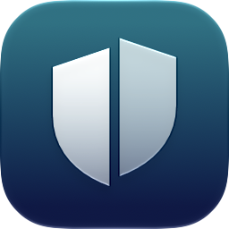
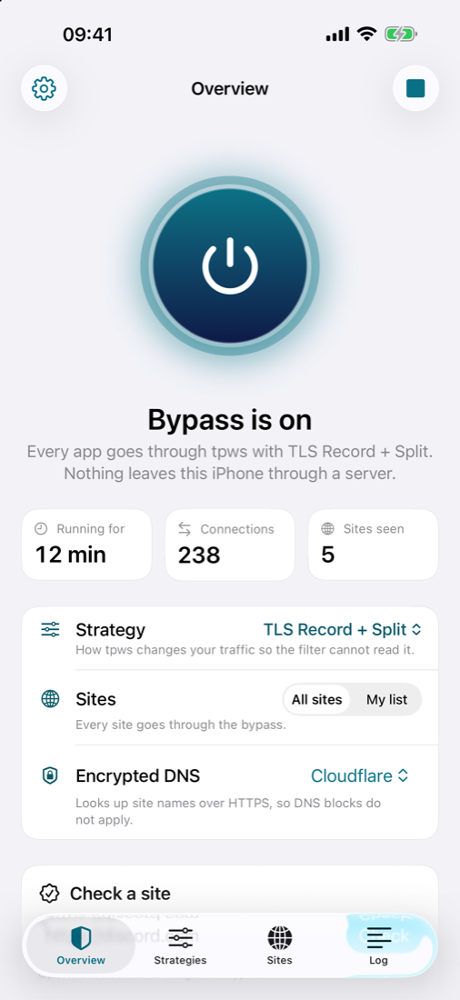
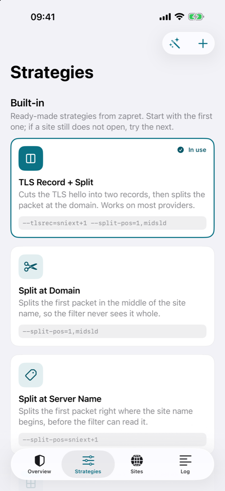
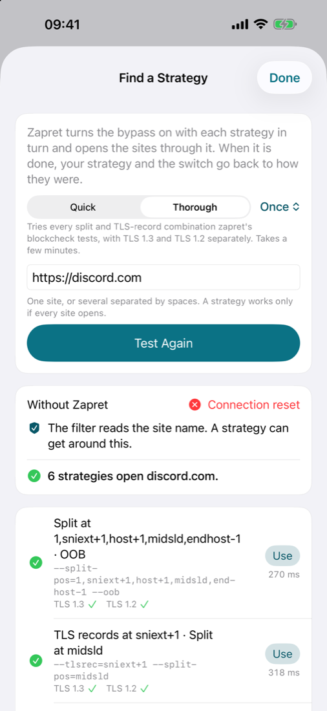
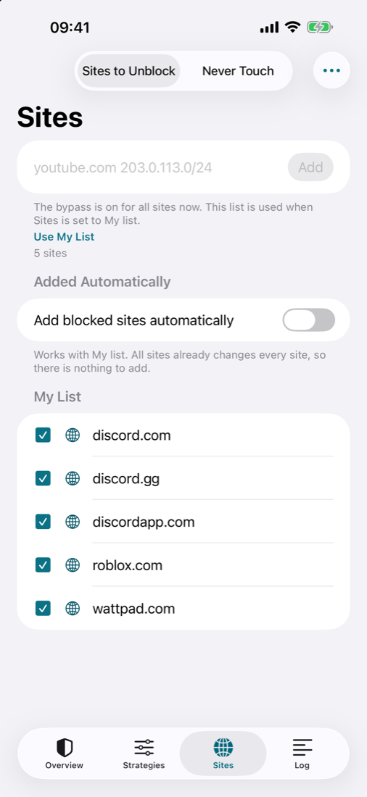
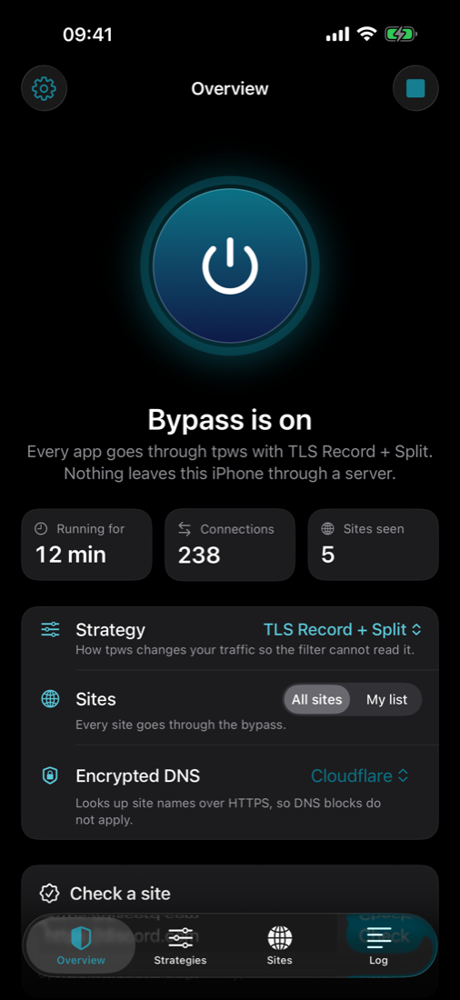
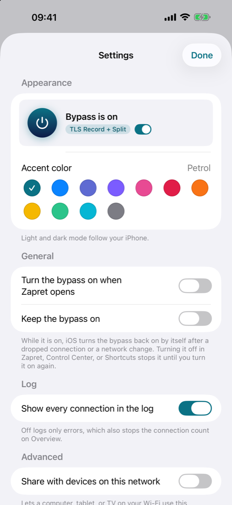

<div align="center">



# ZapretiOS

**A native iPhone and iPad app for [zapret](https://github.com/bol-van/zapret)'s DPI bypass.**
One switch, ready-made strategies, site lists, and a strategy finder, running on your iPhone as a local VPN. The sibling of [ZapretMac](https://github.com/gorlev/ZapretMac).

[](#install)
[](https://swift.org)
[](LICENSE)
[](#languages)

<picture>
  <source media="(prefers-color-scheme: dark)" srcset="docs/images/overview-dark.png">
  
</picture>

</div>

---

## Contents

- [What it does](#what-it-does)
- [Features](#features)
- [Screenshots](#screenshots)
- [Install](#install)
- [Getting started](#getting-started)
- [How it works](#how-it-works)
- [Privacy and safety](#privacy-and-safety)
- [Limitations](#limitations)
- [Development](#development)
- [Languages](#languages)
- [Contributing](#contributing)
- [Acknowledgements and license](#acknowledgements-and-license)

## What it does

Some networks block websites with deep packet inspection (DPI): a filter reads the site name in the first packets of a connection and drops or resets it. zapret's `tpws` gets past many of these filters by splitting and reshaping those first packets, so the filter can no longer read the name. The website itself sees a normal connection.

iOS does not let an app run command-line tools or change the system proxy. ZapretiOS runs `tpws` inside a **local VPN** instead: a Network Extension on your iPhone receives every app's traffic, hands it to `tpws`, and `tpws` connects to the real site. No server is involved, and nothing leaves your iPhone except your own connections.

## Features

**Turn it on**
- **One switch** on the Overview page, in **Control Center**, on a **Home Screen or Lock Screen widget**, or from **Siri, Shortcuts, and the Action button**.
- **Every app** goes through the bypass, over IPv4 and IPv6, with no proxy settings.
- **Encrypted DNS** (Cloudflare or Google, DNS over HTTPS) while the bypass is on, so DNS blocks do not apply either.
- **Keep the bypass on:** iOS turns it back on by itself after a dropped connection or a network change.
- **Share with your network:** a computer, tablet, or TV on the same Wi-Fi can use the bypass through a SOCKS5 address, with a QR code to scan.

**Choose a strategy**
- **Ten built-in strategies** taken from zapret, each explained in plain words, from a simple split to TLS records, disorder, out-of-band bytes, and HTTP header tricks.
- **Your own strategies** built from `tpws` options in a form: split positions, TLS records, disorder, OOB, ports, protocols, and where changes start and stop. Every option is checked against `tpws`'s own rules before you save. Copy and paste flags between devices.
- **Find a Strategy** opens one or more blocked sites with every strategy and ranks what works, fastest first.
  - The *Thorough* scan runs the same `tpws` matrix as zapret's `blockcheck.sh`, testing TLS 1.3 and TLS 1.2 separately and repeating each try if you ask.
  - Before testing, it says what kind of block it found: a DNS block, an IP block, or a filter on the site name.

**Pick the sites**
- **All sites or My list.** *Never Touch* keeps banks, or sites a strategy breaks, out of the bypass.
- **Domains and IP ranges** side by side. Paste many at once, import text files, and undo any change.
- **Subscriptions** to zapret-style host lists and IP lists by URL (gzip too), refreshed daily. Well-known community lists are one tap away.
- **Add blocked sites automatically:** `tpws` adds a site to its own list after a few failed connections. You can review the list, move entries, or clear it.

**See what happens**
- **Check a site** opens an address through the bypass and shows whether it loads.
- **Live log** of `tpws` output and of the tunnel itself, filterable by site or errors, with the exact command to copy.
- **Statistics:** how long the bypass has been running, connections, and sites seen.

**A real iOS app**
- SwiftUI on iOS 26: tabs on iPhone, a sidebar on iPad, Liquid Glass, haptics, and swipe actions.
- Light and dark mode, an accent color you choose, and VoiceOver labels.
- No account, no server, no telemetry.

## Screenshots

<table>
  <tr>
    <td width="33%"></td>
    <td width="33%"></td>
    <td width="33%"></td>
  </tr>
  <tr>
    <td align="center"><sub><b>Strategies:</b> built-in and your own</sub></td>
    <td align="center"><sub><b>Find a Strategy:</b> block diagnosis and ranked results</sub></td>
    <td align="center"><sub><b>Sites:</b> lists, subscriptions, and IP ranges</sub></td>
  </tr>
  <tr>
    <td width="33%"></td>
    <td width="33%"></td>
    <td width="33%"></td>
  </tr>
  <tr>
    <td align="center"><sub><b>Overview:</b> light</sub></td>
    <td align="center"><sub><b>Overview:</b> dark</sub></td>
    <td align="center"><sub><b>Settings</b></sub></td>
  </tr>
</table>

## Install

ZapretiOS is not on the App Store. You build it from source and install it on your own iPhone or iPad.

You need:
- a Mac with **Xcode 26** or later, and [XcodeGen](https://github.com/yonaskolb/XcodeGen) (`brew install xcodegen`);
- an iPhone or iPad with **iOS 26** or later;
- a **paid Apple Developer Program membership**. The VPN uses Apple's Network Extension, which free Apple IDs cannot sign. Add your account in Xcode under **Settings → Accounts**.

```bash
git clone https://github.com/gorlev/ZapretiOS.git
cd ZapretiOS
```

Connect your iPhone with a cable (and turn on **Developer Mode** in **Settings → Privacy & Security** if asked), then:

```bash
ZAPRET_BUNDLE_ID=com.yourname.zapret tools/build-ipa.sh --install
```

`tools/build-ipa.sh`:

1. builds `tpws` and `hev-socks5-tunnel` from `Vendor/` as static libraries for iOS,
2. generates the Xcode project from `project.yml`,
3. signs the app, the VPN extension, and the widget with your Apple Development certificate's team, registering your iPhone and the bundle IDs on your account,
4. writes `build/ipa/ZapretiOS.ipa`,
5. and, with `--install`, installs it on the connected iPhone.

`ZAPRET_BUNDLE_ID` must be a bundle ID your account can register; the default belongs to the author's account. `TEAM_ID=…` picks the team when you have more than one. The provisioning profile lasts a year: run the command again to renew it.

## Getting started

1. **Turn it on.** Tap the round switch. The first time, iOS asks to **add a VPN configuration**: allow it. A VPN icon appears in the status bar.
2. **Check a blocked site.** Type its address under *Check a site*. If it still does not open, use **Find a Strategy** (the magic wand on the Strategies page) and tap **Use** next to a strategy that works.
3. **Make it quick.** Add the **Zapret** control to Control Center, or the widget to your Home Screen.

To touch only some sites, switch *Sites* to **My list** and add them on the Sites page.

## How it works

```
                ┌─────────────────── ZapretTunnel (Network Extension) ───────────────────┐
  Any app ──►   │  utun  ──►  hev-socks5-tunnel  ──►  tpws (SOCKS5, 127.0.0.1)  ──►     │ ──►  Internet
                │             (IP packets → TCP)       (zapret: reshaped first packets)  │
                └─────────────────────────────────────────────────────────────────────────┘
```

- **The app** (`App/`) is the interface. Before each start it writes the strategy and the site list files into a shared App Group container, then starts the VPN through `NETunnelProviderManager`.
- **The tunnel** (`Tunnel/`) is an `NEPacketTunnelProvider`. It runs `tpws` on a thread as a SOCKS5 proxy on `127.0.0.1`, finds the tunnel's `utun` file descriptor, and runs [hev-socks5-tunnel](https://github.com/heiher/hev-socks5-tunnel), which turns the tunnel's IP packets back into TCP connections and hands them to `tpws`. The extension's own sockets skip the tunnel, so `tpws`'s connections go straight to the network.
- **DNS** is DNS over HTTPS, set in the tunnel's network settings. Lookups are TCP, so they go through `tpws` like everything else.
- **`tpws` starts once per extension process**, so changing the strategy or the lists restarts the tunnel (about two seconds). *Find a Strategy* uses the same restart for every try.
- **The widget and Control Center control** (`Widgets/`) and the **App Intents** (`Intents/`) start and stop the same VPN configuration without opening the app.

## Privacy and safety

- **Everything stays on your iPhone.** Settings and lists live in the app's App Group container. Nothing is sent anywhere, and there are no analytics.
- **It is a local VPN.** iOS shows it as a VPN because that is the only way to see every app's traffic, but there is no VPN server: traffic leaves through your own network, as without ZapretiOS.
- **Network requests the app makes itself:** subscription and suggested-list downloads you add; *Check a site* and *Find a Strategy* opening the sites you type; encrypted DNS lookups to the provider you pick (Cloudflare or Google) while the bypass is on; and, for block diagnosis, a DNS-over-HTTPS lookup of those sites.
- **Built from source.** `tpws` and `hev-socks5-tunnel` are compiled from the vendored sources during the build; the repository contains no prebuilt binaries.

## Limitations

- **TCP only.** zapret's `nfqws`, which handles UDP and QUIC, cannot run on iOS. UDP traffic (QUIC, HTTP/3) is dropped while the bypass is on, and apps fall back to TCP.
- **One VPN at a time.** iOS runs one VPN; turning on another one turns ZapretiOS off.
- **Memory.** iOS limits a VPN extension to about 50 MB. `tpws` keeps every list entry in memory, so the app warns when your subscriptions hold more than about 250,000 entries.
- **Strategies depend on your network.** What works on one provider may not work on another, which is what *Find a Strategy* is for.
- **IP blocks** cannot be bypassed by `tpws`. *Find a Strategy* tells you when that is the problem.
- **Shortcuts and Control Center** start the bypass with the settings from its last start in the app.
- **The simulator** shows the interface, but the VPN only runs on a real iPhone or iPad.

## Development

```
App/            the app (SwiftUI): pages, Find a Strategy, site lists, settings
Tunnel/         the Packet Tunnel extension: starts tpws and hev-socks5-tunnel
Widgets/        the Home Screen / Lock Screen widget and the Control Center control
Intents/        App Intents for Siri, Shortcuts, and the Action button
Shared/         code in every target: presets, strategies, tunnel settings, list files
Native/         the iOS glue for the C engines (headers, a wordexp shim)
Localization/   translations, one JSON file per language
Icon/           the app icon (Icon Composer) and accent color
Vendor/         zapret's sources (tpws) and hev-socks5-tunnel
tools/          build scripts, localization tools, Find a Strategy logic checks
project.yml     the XcodeGen spec; the Xcode project is generated, never committed
```

| Check | Command |
|---|---|
| Simulator build | `xcodegen generate && xcodebuild -project ZapretiOS.xcodeproj -scheme ZapretiOS -sdk iphonesimulator -destination 'platform=iOS Simulator,name=iPhone 17 Pro Max' -derivedDataPath build/DD CODE_SIGNING_ALLOWED=NO build` |
| Find a Strategy logic | `tools/check-finder.sh` |
| Translations | `python3 tools/l10n.py check` |
| Signed IPA | `tools/build-ipa.sh` |

Debug builds have sample states for screenshots: launch with `ZAPRET_DEMO=on` for a running bypass, or `ZAPRET_FINDER_SAMPLE=start|progress|verdict` for Find a Strategy.

## Languages

English, Türkçe, Deutsch, Español, Italiano, Français, Português (Brasil), and Русский. ZapretiOS follows your iPhone's language, or the language you choose for it in **Settings → Apps → Zapret → Language**.

The translations were written to read naturally in each language rather than word for word. Improvements are welcome; see [Localization/BRIEF.md](Localization/BRIEF.md) for the tone and terms.

## Contributing

Bug reports, strategy reports, translations, and code are all welcome. Questions go in [Discussions](https://github.com/gorlev/ZapretiOS/discussions), bugs and ideas in [Issues](https://github.com/gorlev/ZapretiOS/issues/new/choose), and security problems through a [private report](SECURITY.md). Before opening a pull request, read [CONTRIBUTING.md](CONTRIBUTING.md).

## Acknowledgements and license

ZapretiOS is a graphical front end for **[zapret](https://github.com/bol-van/zapret)** by **bol-van**. All of the actual bypass work is done by zapret's `tpws`. Packets reach it through **[hev-socks5-tunnel](https://github.com/heiher/hev-socks5-tunnel)** by **heiher**. ZapretiOS is not affiliated with either project.

ZapretiOS is released under the [MIT License](LICENSE). zapret, vendored under `Vendor/zapret`, is MIT-licensed; see [Vendor/zapret/LICENSE.txt](Vendor/zapret/LICENSE.txt). hev-socks5-tunnel, vendored under `Vendor/hev-socks5-tunnel`, is MIT-licensed; see [Vendor/hev-socks5-tunnel/LICENSE](Vendor/hev-socks5-tunnel/LICENSE).

> [!NOTE]
> ZapretiOS is meant to help people reach information on networks that block it. You are responsible for following the laws and rules that apply where you use it.
